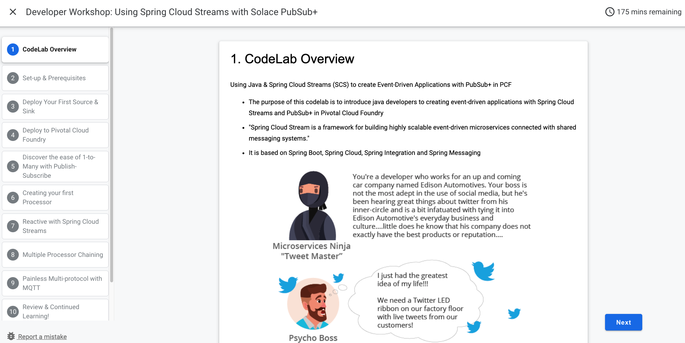

authors: Vilton.tech
summary: Un codelab de demostración para validar el flujo completo de autoría y publicación en Vilton Codelabs.
id: vilton-demo
categories: demo,vilton
environments: Web
status: Published
feedback link: https://github.com/viltontech/tools/issues
tags: demo,primeros-pasos

# Tu primer codelab en Vilton

## Bienvenida
Duration: 0:02:00

Este es un codelab de demostración. Sirve para ver cómo se transforma un archivo Markdown en un tutorial interactivo con pasos, barra de progreso y tiempo estimado.

### Qué vas a aprender

* Cómo se estructura un codelab en Markdown
* Qué construcciones especiales existen: infoboxes, botones, código
* Cómo se exporta y se sirve el resultado

### Requisitos

* Un editor de texto
* El binario `claat` compilado desde este repositorio
* Ganas de aprender

Positive
: Los infoboxes positivos sirven para consejos y buenas prácticas. Este es uno.

Negative
: Los infoboxes negativos sirven para advertencias. No borres la carpeta `img` después de exportar.

## Escribí el contenido
Duration: 0:05:00

Cada paso del codelab es un encabezado de nivel 2. Lo que sigue hasta el próximo encabezado de nivel 2 pertenece a ese paso.

### codelabs/vilton-demo.md

```markdown
## Nombre del paso
Duration: 0:03:00

Contenido del paso en Markdown normal.
```

La línea `Duration` es opcional. Si falta, el paso cuenta como un minuto.

### Código con resaltado

El renderizador resalta sintaxis según el lenguaje que indiques en el bloque:

```javascript
export function saludar(nombre) {
  return `Hola, ${nombre}. Bienvenido a Vilton Codelabs.`;
}
```

```bash
./claat/bin/claat export -o build codelabs/vilton-demo.md
```

### Tablas

| Construcción | Sintaxis | Resultado |
|---|---|---|
| Paso | `## Título` | Nueva sección en el índice lateral |
| Infobox | `Positive` + `: texto` | Recuadro verde |
| Botón | enlace que empieza con "Download" | Botón con icono |

## Imágenes y botones
Duration: 0:03:00

Las imágenes locales se copian a la carpeta `img` del codelab exportado, con un nombre basado en su hash.



Los enlaces cuyo texto empieza con la palabra "Download" se renderizan como botón:

<button>[Download el código de ejemplo](https://github.com/viltontech/tools/archive/refs/heads/main.zip)</button>

## Exportá y publicá
Duration: 0:04:00

Con el archivo listo, exportá el codelab a HTML:

```bash
./claat/bin/claat export -o build codelabs/vilton-demo.md
```

El resultado es una carpeta `build/vilton-demo` con un `index.html`, un `codelab.json` con los metadatos y la carpeta `img`.

Para verlo en local, serví la carpeta `build` con cualquier servidor estático:

```bash
python3 -m http.server 9090 --directory build
```

Positive
: Todo lo generado es estático. Se puede publicar en GitHub Pages, Cloudflare Pages, Netlify o un bucket.

## Felicitaciones
Duration: 0:00:00

Completaste el codelab de demostración.

### Qué cubrimos

* Estructura de un codelab en Markdown
* Infoboxes, código, tablas, imágenes y botones
* Exportación y servido en local

### Próximos pasos

* Escribí tu propio codelab en la carpeta `codelabs`
* Revisá la [guía de formato](https://github.com/viltontech/tools/blob/main/FORMAT-GUIDE.md)
